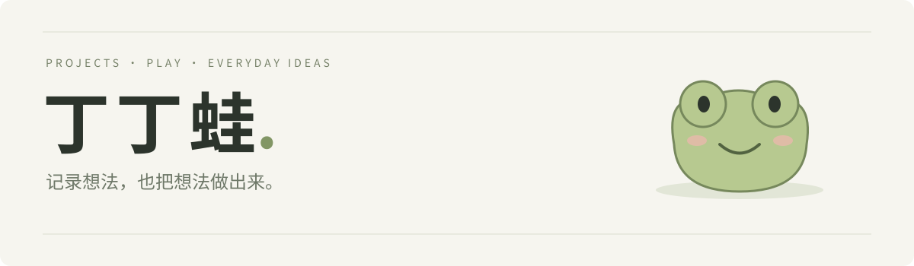
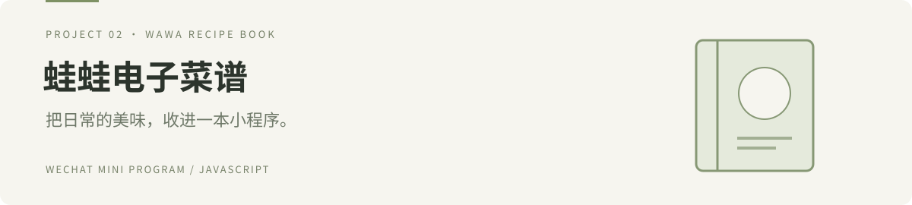
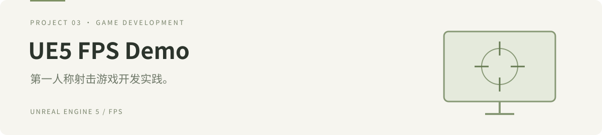

**中文 / English**

### 你好，我是丁丁蛙 👋 · Hi, I’m Dingdingwa

**记录想法，也把想法做出来。**  
Turning everyday ideas into projects.

这里记录我的项目与实践：从城市美食探索、微信小程序，到游戏开发。
喜欢从日常生活里找灵感，在一次次尝试中把想法变成看得见的作品。

I explore web experiences, WeChat mini programs, and game development—finding inspiration in everyday life and learning by building.

---

## 作品 · Selected Projects

**食迹中国 · Shiji China**  
以真实地图为主界面的中国城市美食探索平台，首版从福州开始。

A map-based platform for exploring food across Chinese cities, starting with Fuzhou.

[查看项目 / View project →](https://github.com/shunading-commits/shiji-china)

**蛙蛙电子菜谱 · Wawa Recipe Book**  
微信原生电子菜谱小程序，记录我的小程序开发实践。

A native WeChat recipe mini program, documenting my hands-on exploration of mini program development.

[查看项目 / View project →](https://github.com/shunading-commits/wawa-recipe-book)

**UE5 FPS Demo**  
使用 Unreal Engine 5 制作的第一人称射击作业项目。

A first-person shooter assignment built with Unreal Engine 5.

[查看项目 / View project →](https://github.com/shunading-commits/TencentFPSDemo)

---

一点好奇心，一点行动力。 · Stay curious. Keep making.

